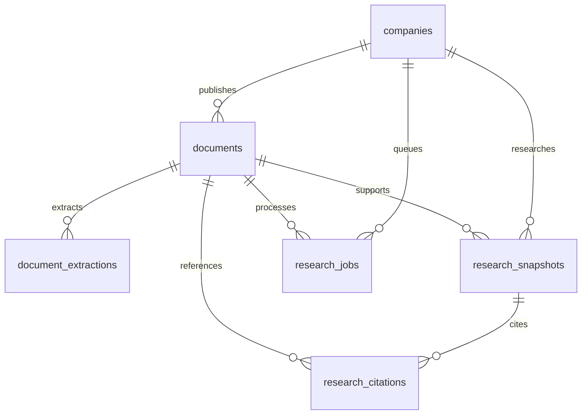

# Dynamic research and PostgreSQL

Current implementation: 30 October 2026 (Asia/Calcutta). Earlier audit entries
describe earlier releases, not this architecture. See
[implementation plan](DYNAMIC_RESEARCH_PLAN.md) and
[verification evidence](verification/dynamic-api-2026-10-30.json).

## What works

FINN preserves its FastAPI/Next.js application, 18-company portfolio, market
ingestion, anomaly detection, settings/localStorage, navigation and the original
two Infosys research routes. Dynamic research now uses PostgreSQL, an explicit
Alembic schema, official company discovery, on-demand retrieval, page artifacts,
durable jobs, source-grounded snapshots and persisted citations.

The genuine end-to-end check searched **ITC**, which was not in the original
company configuration, discovered official documents, selected the Q4 FY2025
results press release, downloaded it, verified issuer identity and SHA-256,
extracted 10 pages and persisted eleven exact source citations, including the financial figures and accounting basis. A repeated request
reused the same snapshot and verified document cache. This is real external
source/PostgreSQL/API verification, separately recorded from synthetic tests.

The deployed database URL is private and is not documented or committed here.

## Local setup

Use Python 3.13 and Node 20.19+ (Node 24 was verified). The old `.venv` points to
a missing Python 3.11 installation in the verification environment; preserve it
and create a fresh environment if necessary.

```powershell
cd finn-backend
py -3.13 -m venv .venv-dynamic
.\.venv-dynamic\Scripts\Activate.ps1
python -m pip install -r requirements.txt
# First setup only; do not overwrite an existing .env.
Copy-Item .env.example .env
```

Set `DATABASE_URL` in `.env` using your own PostgreSQL connection string. Hosted
providers are supported, including `postgres://` URLs, TLS query parameters,
percent-encoded credentials and IPv4-compatible session poolers. **Use a direct
connection or session pooler, not a transaction pooler**, because the worker
holds a dedicated transaction for document advisory locks. Never put the URL in frontend configuration.

```powershell
python -m alembic upgrade head
python -m app.seed
# Optional pre-population; the UI can also request a registry refresh.
python -m app.research_admin refresh-registry
python -m uvicorn app.main:app --env-file .env --host 127.0.0.1 --port 8000
```

Run the worker in another terminal, with the same environment, database schema
and persistent artifact directory:

```powershell
cd finn-backend
.\.venv-dynamic\Scripts\Activate.ps1
python -m app.worker
```

Then run the frontend:

```powershell
cd finn-frontend
npm.cmd ci
# First setup only:
Copy-Item .env.example .env.local
npm.cmd run dev
```

Open `/research`. Search by company name or NSE symbol, choose the matching
company, discover official documents, choose the reporting document and click
**Retrieve and generate research**. The existing April/July Infosys selector
remains below the dynamic research panel. Jobs show queued/downloading/verifying/
extracting/preparing/ready states. If jobs remain queued, start the worker.

## Configuration

| Setting | Default / purpose |
|---|---|
| `DATABASE_URL` | Required for dynamic research; no embedded default password. |
| `DATABASE_SCHEMA` | `public`; identifier validated and ORM tables explicitly schema-qualified. Create a custom schema before migration if using one. |
| `DATABASE_POOL_SIZE` | 5 connections per process. |
| `DATABASE_MAX_OVERFLOW` | 5 extra connections per process; combined capacity must be at least 3 for the worker. |
| `DATABASE_POOL_TIMEOUT` | 10 seconds waiting for a pooled connection. |
| `DOCUMENT_STORAGE_DIR` | `finn-backend/data/documents`; must be persistent and shared between API/admin/worker processes. |
| `DOCUMENT_CACHE_HOURS` | 24; allowed 1–720. Expired artifacts are re-fetched before generating fresh research. |
| `DOCUMENT_RETENTION_DAYS` | 30 days after expiry; allowed 1–3650. Cleanup is explicit. |
| `RESEARCH_PROVIDER` | `extractive`, or `compatible_llm` for an optional model-assisted evidence selector. |
| `RESEARCH_LLM_URL`, `RESEARCH_LLM_MODEL`, `RESEARCH_LLM_API_KEY` | Optional HTTPS OpenAI-compatible chat-completions provider. Never exposed to the frontend. |
| `RESEARCH_CACHE_DIR` | Existing pinned Infosys PDF/metadata cache, unchanged. |
| `ALLOWED_ORIGINS` | Exact comma-separated frontend origins. GET/POST are allowed. |
| `NEXT_PUBLIC_API_URL` | Frontend API base ending in `/api`; production requires explicit HTTPS. |

Pool connections use pre-ping, 15-second connection/SQL statement limits and
disabled automatic prepared statements for hosted-pooler compatibility. Remote
URLs default to TLS (`sslmode=require`) when no TLS setting is provided. Pool
capacity multiplies with the number of processes. Missing database configuration
produces a clear HTTP 503 on the new routes; legacy market and reviewed-Infosys
routes still work. Invalid supplied configuration fails startup. Startup never
creates tables.

## Tables and relationships



- `companies`: names, normalized search key, unique NSE/BSE identifiers, sector,
  portfolio membership and registry provenance/timestamp.
- `documents`: issuer, type, title, reporting period, publication date when
  explicitly supplied, original URL/domain/discovery page, hash, byte count,
  storage key, retrieval/extraction/verification status and expiry. `pinned`
  protects reviewed historical sources. Company+source URL is unique.
- `document_extractions`: document hash, extraction version, content-addressed
  page JSON reference/checksum, page count, status and extraction timestamp.
- `research_snapshots`: issuer/document/hash/period, template/extraction/provider
  version, cache identity, structured JSON, status and generation/expiry times.
  Older snapshots remain in history and are marked superseded when bytes change.
- `research_citations`: snapshot/document foreign keys, one-based page, section,
  exact quoted text, claim ID and page-linked original URL.
- `research_jobs`: durable queue, progress/error/result and timestamps. No Redis.

No authentication, users or persistent user settings were introduced: there is
no established user identity. Existing browser settings remain compatible.

## Migration and pinned evidence

Alembic revision `0001_research` creates the schema. `python -m app.seed` imports
the 18 configured portfolio companies transactionally, then both reviewed
Infosys documents. It checks immutable provenance and local PDF bytes, imports
page artifacts plus original seven claims/citations per document, and never
overwrites conflicting pinned records. Reruns do not duplicate companies,
documents or imported snapshots. No old cache files are removed.

| ID | Historical period / call date | Preserved SHA-256 |
|---|---|---|
| `infosys-q4-fy25-call` | Q4 / FY25; 17 April 2025 | `2e4ccd145dd8a746cfcf4ac3ba8b23ca2080f90da1072a8d6010b968abe37e4e` |
| `infosys-q1-fy26-call` | Q1 / FY26; 23 July 2025 | `09fe2ca57d9dbfcdb707bf924041791ac7676fd03253a5869abba4204ed98e72` |

The original `research_sources.json` and legacy research service were not
modified. Call dates remain call dates, not invented publication dates. A pinned
hash change fails closed; it does not replace the historical source. Database
import was run twice: 18 portfolio companies, two pinned documents, verified
local bytes and 14 original citations. Registry refresh may update names from
the official master while retaining portfolio membership and pinned provenance.

## Discovery and source policy

Company search uses the official NSE equity CSV linked from
[NSE securities available for trading](https://www.nseindia.com/static/market-data/securities-available-for-trading).
The live import verified 2,618 registry entries. Search is paginated and returns
multiple matches rather than silently resolving ambiguous names. Query strings
are not inserted as companies. Configured portfolio records remain available if
the registry source fails. BSE codes can be searched when verified values are
present; an automated BSE master importer is not currently implemented.

Document discovery tries NSE corporate filings, then reviewed issuer IR listing
adapters. Current IR policies are ITC, Hindustan Unilever and Infosys; other
registry companies can use NSE filings when the source is available. BSE filing
discovery is explicitly reported as unconfigured. Adding an IR source requires
reviewing the issuer identity/domain/listing in `discovery_sources.json`, not
manually collecting PDFs. Discovery reads live listing links and never invents
PDF paths. Responses are capped at 200 documents per discovery job; listings are
not an exhaustive historical archive.

Exact HTTPS host allowlists, public-IP checks, robots rules, a transparent user
agent, host delays, no redirects, bounded requests and no challenge/cookie bypass
govern retrieval. An unavailable/denied official source returns an explicit
issue. Publication dates and reporting periods stay null when the listing does
not explicitly provide them. Source-verified metadata is distinct from a
downloaded PDF whose text identity has been verified.

## Storage, extraction and retention

PostgreSQL stores metadata and snapshots; `Storage`/`FileStorage` stores actual
PDF bytes and page JSON. Keys are content hashes, writes are atomic, and every
read rechecks the artifact hash. File paths are not returned by the API.
Only selected PDFs are downloaded. Retrieval validates HTTP/content type/size,
PDF structure, issuer identity and pinned hashes. Files are limited to 20 MB,
500 pages and bounded extracted text. The PDF parser runs in a subprocess with
a 40-second timeout. Temporary parser files are removed automatically.

Scanned/encrypted/invalid/oversized PDFs fail explicitly. OCR is not configured.
Documents whose logos contain the only issuer name can fail text identity
verification; the ITC presentation exhibited this and was not silently used.
Its separate official results press release passed all checks.

```powershell
python -m app.research_admin cleanup          # dry run
python -m app.research_admin cleanup --apply  # expired non-pinned artifacts only
```

Cleanup holds document locks, protects shared artifacts, marks metadata expired,
retains snapshot history and **never deletes pinned Infosys documents or the
legacy cache**. It is not scheduled automatically. Keep database/storage backups
before deployment or retention policy changes. Atomic file writes can leave
unreferenced artifacts if the subsequent database transaction fails; orphan
artifact reconciliation is a remaining operational task.

## Evidence and model behavior

The default provider selects section-related, exact page excerpts. It is labeled
**deterministic**, not AI-written financial analysis. Optional `compatible_llm`
selects evidence IDs using a strict Pydantic output schema. It cannot emit
financial figures, calculations, URLs or free-form claims. Every returned ID is
checked against the candidate set and every quote against its original page.
Source text is untrusted data; no source instruction is executed and no model
tools are enabled. Pinned documents always use their original reviewed selectors.

Business/performance/guidance/risk sections explicitly show insufficient evidence
where appropriate. Dynamic excerpts are labeled source excerpts because keyword
selection does not establish whether every sentence is an actual, forecast or
prior-period statement. A conservative deterministic financial extractor accepts explicit narrative figures
only when metric, currency, units, fiscal period, accounting basis and continuing/
discontinued-operation scope are established by source text. It rejects ambiguous
or conflicting figures. Both the value and the accounting-basis passage are cited.
The real ITC check extracted FY2025 standalone continuing-operations gross revenue
of INR 73,464.55 crore and EBITDA of INR 24,024.83 crore.

Decimal calculations now produce QoQ/YoY changes and Narrative vs Numbers only
when matching explicit source values exist. Guidance, actual and prior-period
inputs retain their evidence IDs. Unit, currency, basis, scope and fiscal-period
mismatches block comparison; a zero baseline produces no percentage. Absolute
margin differences are labeled percentage points. The live ITC source has no
matching numerical guidance, so its comparison correctly remains insufficient
evidence. Supported grammars and calculations have synthetic positive/negative
tests; no live successful guidance-versus-actual comparison is claimed.

**General financial-table layout reconciliation remains unimplemented.** Missing
metrics, ambiguous rounded figures, unsupported layouts and implicit context are
not inferred. The previous hardcoded UI comparisons were removed.

Cache identity includes company, document, SHA-256, reporting period, research
template, extraction version and provider version. Changed bytes supersede old
extractions/snapshots. Cache responses preserve original generation/retrieval
timestamps; expired history is explicitly marked. Model synthesis and OCR remain
optional future work; no live LLM call was claimed or tested without credentials.

## API

Legacy `/api/research/companies` and `/api/research/{ticker}?document_id=...`
remain compatible. New endpoints are under `/api/research/v2`:

| Method/path | Purpose |
|---|---|
| `GET /companies?q=&limit=&offset=` | Validated registry search |
| `GET /companies/{id}` | Company and registry provenance |
| `POST /registry-refresh` | Queue official NSE master refresh |
| `POST /companies/{id}/discover` | Queue live source discovery |
| `GET /companies/{id}/documents?limit=&offset=` | Stored document metadata |
| `GET /documents/{id}` | Retrieval/verification/extraction status |
| `POST /documents/{id}/retrieve` | Queue download and extraction |
| `POST /documents/{id}/research` | Queue retrieval then research |
| `GET /jobs/{id}` | Actual progress, safe errors and result IDs |
| `GET /snapshots/{id}` | Typed persisted snapshot with expiration status |
| `GET /companies/{id}/history?limit=&offset=` | Paginated research history |

POST requests return HTTP 202. Unknown records return 404, malformed query values
422, queue limits 429 and unavailable database 503. No request holds the browser
connection open while downloading PDFs. The worker can resume jobs after a
process restart; PostgreSQL document locks prevent duplicate concurrent work.
Global admission limits: 30 pending jobs, 20 newly submitted jobs/minute and five
per company/minute. These are shared database limits, not user identities.

## Validation commands

```powershell
# Backend directory
python -m unittest discover -s tests -v
python verify_database.py
$env:FINN_POSTGRES_TESTS='1'
python -m unittest discover -s tests -p test_postgres_integration.py -v
Remove-Item Env:FINN_POSTGRES_TESTS
python verify_dynamic_source.py
python verify_dynamic_api.py
python verify_research.py --fresh
python verify_research.py --fresh --document-id infosys-q1-fy26-call

# Frontend directory
npm.cmd test
npm.cmd run lint
$env:NEXT_PUBLIC_API_URL='https://your-real-backend.example/api'
npm.cmd run build
```

The normal suite mocks external sources and uses synthetic PDFs; the opt-in
PostgreSQL suite creates/migrates/drops its own `finn_test_<random>` schema and
does not delete app tables. It requires schema-creation permission. Real-source
scripts separately verify actual official bytes and the real database-backed
workflow. Browser script `tests/dynamic-browser.mjs` uses isolated Playwright
tooling under `tmp/browser-tools`, `FINN_CHROMIUM_PATH`, and running local servers
plus the worker. It clearly labels mocked outage cases. This is local validation,
not a hosted frontend/backend deployment.

## Deployment and remaining work

1. Back up PostgreSQL and the retained document cache. Set a dedicated app schema
   and least-privilege database role; provide a separate migration role if needed.
2. Install pinned backend requirements, supply the PostgreSQL/session-pooler URL,
   exact CORS origins and persistent shared artifact volume. Run Alembic once,
   then the idempotent import and registry refresh.
3. Run the API and a supervised lightweight worker. Use a direct/session-pooled
   connection for advisory-lock correctness; do not use transaction pooling.
4. Build the frontend with the actual HTTPS API URL. No deployment has occurred
   in this task, and the `.invalid` URL used for build verification is not a service.
5. Configure backup/restore, cleanup scheduling, job/error monitoring and an edge
   rate limiter before public exposure. There is intentionally no login screen.
6. If using multiple worker hosts, use shared persistent storage or implement the
   storage protocol for an object store. The repository currently supplies the
   filesystem adapter only. Restrict worker outbound networking in production.

Highest-priority functional follow-up: broaden and validate financial-table
extraction beyond the supported explicit narrative grammars, with real-source
golden fixtures for units, accounting basis and period matching. Other limitations: BSE discovery,
OCR, wider IR adapters, incomplete archive pagination, optional LLM live testing,
orphan-file reconciliation and a production deployment remain outstanding.
