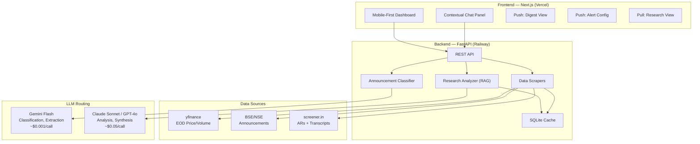

# FINN — Build Plan (4 Days)

> **Decisions locked.** This plan is the execution blueprint.

---

## Architecture



---

## Portfolio — 18 Companies

| # | Ticker | Company | Sector | Size |
|---|--------|---------|--------|------|
| 1 | RELIANCE.NS | Reliance Industries | Energy/Conglomerate | Large |
| 2 | TCS.NS | Tata Consultancy Services | IT | Large |
| 3 | HDFCBANK.NS | HDFC Bank | Banking | Large |
| 4 | INFY.NS | Infosys | IT | Large |
| 5 | BHARTIARTL.NS | Bharti Airtel | Telecom | Large |
| 6 | SUNPHARMA.NS | Sun Pharma | Pharma | Large |
| 7 | BAJFINANCE.NS | Bajaj Finance | NBFC | Large |
| 8 | PIDILITIND.NS | Pidilite Industries | Chemicals | Mid |
| 9 | TRENT.NS | Trent Ltd | Retail | Mid |
| 10 | PERSISTENT.NS | Persistent Systems | IT (Mid) | Mid |
| 11 | CUMMINSIND.NS | Cummins India | Industrials | Mid |
| 12 | POLYCAB.NS | Polycab India | Electricals | Mid |
| 13 | ASTRAL.NS | Astral Ltd | Building Materials | Mid |
| 14 | CDSL.NS | CDSL | Financial Infra | Mid |
| 15 | GRINDWELL.NS | Grindwell Norton | Industrials (Small) | Small |
| 16 | KAYNES.NS | Kaynes Technology | Electronics (EMS) | Small |
| 17 | IIFL.NS | IIFL Finance | NBFC (Small) | Small |
| 18 | AFFLE.NS | Affle India | Ad-tech | Small |

### Additional Pull-Research Demo Companies (3–5)

| Ticker | Company | Why |
|--------|---------|-----|
| TITAN.NS | Titan Company | Strong narrative arc, rich concalls |
| DMART.NS | Avenue Supermarts | Great financials, minimal guidance — interesting contrast |
| ZOMATO.NS | Zomato | Profitability inflection, lots of guidance to track |
| DIXON.NS | Dixon Technologies | EMS boom, aggressive guidance, good narrative vs. numbers case |
| MARICO.NS | Marico | Stable FMCG, clear guidance history |

---

## 4-Day Timeline

### Day 1 — Foundation + Data + Deploy (Tue Oct 28)

**Goal:** Skeleton app deployed on mobile. All data pipelines working. Cached data for demo set.

| Time | Task | Detail |
|------|------|--------|
| **2h** | **Project scaffold** | Next.js app (frontend), FastAPI app (backend), monorepo structure, deploy both to Vercel + Railway immediately |
| **2h** | **EOD data pipeline** | yfinance integration — fetch last 6 months of daily OHLCV for all 18+5 tickers. Store in SQLite. Anomaly detection (volume > 2× 20-day avg, price ±3%) |
| **2h** | **Announcement scraper** | BSE announcement feed scraper. Pre-cache last 30 days for all portfolio companies. Fallback to cached JSON if scraper fails |
| **1h** | **screener.in ingestion** | Script to download AR links and concall transcript links for the 5 pull-demo companies. Store PDFs/text locally |
| **1h** | **Mobile UI shell** | Bottom-nav layout (Dashboard / Alerts / Research / Settings). Dark-mode design system. Premium typography (Inter/Outfit). Deploy and verify on phone |
| **1h** | **API skeleton** | Endpoints: `/portfolio`, `/digest`, `/alerts`, `/research/{ticker}`, `/chat`. CORS, error handling |
| **1h** | **End-of-day deploy & phone test** | Everything wired. App loads on phone. Shows portfolio list with prices |

### Day 2 — Push Mode (Wed Oct 29)

**Goal:** Digest view and alerts fully working. Announcements classified and enriched.

| Time | Task | Detail |
|------|------|--------|
| **2h** | **Announcement classification** | LLM-based classification into the 17 categories using Gemini Flash. Batch classify all cached announcements. Cache results |
| **2h** | **Digest view UI** | Time-window selector (24h, 3d, 7d, custom). Announcements grouped by company, sorted by priority (material first). Collapsible routine items. One-line AI summaries |
| **2h** | **Results enrichment** | When category=results: extract Revenue, EBITDA, PBT, PAT from the filing. Compute QoQ and YoY. Render as a compact comparison card |
| **2h** | **Price/Volume alerts** | Alert configuration UI (volume threshold, price % threshold, announcement types). Backend computes alerts on EOD data. Alert badges + alert detail cards |
| **2h** | **Polish push mode** | Animations, transitions, density optimization, mobile scroll behavior. Test on phone |

### Day 3 — Pull Mode + RAG (Thu Oct 30)

**Goal:** Research view works for demo companies. Narrative vs. Numbers is the showpiece.

| Time | Task | Detail |
|------|------|--------|
| **2h** | **Document processing** | Parse ARs (PDF → text chunks) and concall transcripts. Chunk and embed using a lightweight embedding model. Store in ChromaDB or simple vector index |
| **2h** | **RAG pipeline** | Query pipeline: user question → retrieve relevant chunks → synthesise with Claude/GPT-4o. System prompt enforces primary-source grounding |
| **2h** | **Business + Financial Snapshot** | Auto-generate from AR: what the company does, segments, revenue mix, headline numbers (Revenue, EBITDA, PAT, margins, D/E, ROCE). Render as a dense, beautiful card layout |
| **3h** | **Narrative vs. Numbers** | Extract management guidance from last 4 concalls (growth %, margin targets, capex). Compare against actual quarterly results. Render as a divergence chart / scorecard. This is the hero feature |
| **1h** | **Contextual chat** | Chat interface on the research view. User can ask follow-up questions grounded in the same primary sources. Render responses with source citations |

### Day 4 — Polish + Generalize + Ship (Fri Oct 31)

**Goal:** Premium mobile experience. Works on arbitrary tickers. Writeup done.

| Time | Task | Detail |
|------|------|--------|
| **2h** | **Generalization** | Test with 2-3 tickers NOT in the demo set. Ensure graceful degradation (price/volume always works; announcements work if available; research works if AR/transcripts are fetchable) |
| **2h** | **Design polish** | Micro-animations, glassmorphism cards, gradient accents, loading states, empty states, error states. Every screen must feel premium |
| **1h** | **Novel interaction element** | Add one "wow" — e.g., swipeable announcement triage cards, or a morning briefing audio summary, or a "what did I miss?" quick-catch-up mode |
| **1h** | **Performance & cost** | Ensure all LLM calls are cached. Verify model routing is efficient. Add a small "powered by" indicator showing which model was used |
| **2h** | **Writeup** | Cover: what I built, key decisions, tradeoffs, what I left out, where I'd take it next. Include model routing strategy and cost breakdown |
| **2h** | **Final deploy + test** | Full end-to-end test on mobile. Record a backup demo video. Final push to GitHub. Submit |

---

## File Structure

```
enam_holding/
├── finn-frontend/                # Next.js app
│   ├── src/
│   │   ├── app/                  # App router pages
│   │   │   ├── layout.tsx        # Root layout — mobile-first, dark mode
│   │   │   ├── page.tsx          # Dashboard (Push digest)
│   │   │   ├── alerts/           # Alert configuration
│   │   │   ├── research/         # Pull mode — company research
│   │   │   │   └── [ticker]/     # Dynamic route per ticker
│   │   │   └── settings/         # Portfolio & threshold config
│   │   ├── components/
│   │   │   ├── ui/               # Design system primitives
│   │   │   ├── digest/           # Digest cards, filters, timeline
│   │   │   ├── alerts/           # Alert badges, config forms
│   │   │   ├── research/         # Snapshot cards, narrative chart, chat
│   │   │   └── layout/           # Nav, header, mobile shell
│   │   ├── lib/
│   │   │   ├── api.ts            # Backend API client
│   │   │   └── utils.ts          # Formatters, helpers
│   │   └── styles/
│   │       └── globals.css       # Design tokens, dark mode, animations
│   ├── public/
│   ├── next.config.js
│   └── package.json
│
├── finn-backend/                 # Python FastAPI
│   ├── app/
│   │   ├── main.py               # FastAPI app, CORS, routes
│   │   ├── routers/
│   │   │   ├── portfolio.py      # Portfolio CRUD, EOD data
│   │   │   ├── digest.py         # Announcement digest endpoint
│   │   │   ├── alerts.py         # Alert config & computation
│   │   │   ├── research.py       # Pull research endpoints
│   │   │   └── chat.py           # Chat endpoint
│   │   ├── services/
│   │   │   ├── market_data.py    # yfinance wrapper
│   │   │   ├── announcements.py  # BSE/NSE scraper
│   │   │   ├── documents.py      # AR/transcript fetcher
│   │   │   ├── classifier.py     # LLM announcement classifier
│   │   │   ├── enricher.py       # Results enrichment, bio lookup
│   │   │   ├── analyzer.py       # RAG research analyzer
│   │   │   └── llm.py            # LLM routing (model selection, caching)
│   │   ├── models/               # Pydantic schemas
│   │   └── db/
│   │       ├── database.py       # SQLite setup
│   │       └── cache.py          # LLM response cache
│   ├── data/                     # Pre-cached data (JSON, PDFs)
│   ├── requirements.txt
│   └── Dockerfile
│
└── README.md
```

---

## Model Routing — Cost Breakdown

| Task | Model | Est. calls | Cost/call | Total |
|------|-------|-----------|-----------|-------|
| Announcement classification (18 co × ~20 each) | Gemini Flash | ~360 | $0.001 | $0.36 |
| Announcement one-line summary | Gemini Flash | ~360 | $0.001 | $0.36 |
| Results number extraction | Gemini Flash | ~30 | $0.001 | $0.03 |
| AR/Transcript chunk embedding | text-embedding-3-small | ~500 | $0.0001 | $0.05 |
| Business snapshot generation (5 co) | GPT-4o-mini | 5 | $0.02 | $0.10 |
| Financial snapshot (5 co) | GPT-4o-mini | 5 | $0.02 | $0.10 |
| Narrative vs. Numbers (5 co) | Claude Sonnet | 5 | $0.05 | $0.25 |
| Chat follow-ups (est. 20) | GPT-4o-mini | 20 | $0.02 | $0.40 |
| **Total** | | | | **~$1.65** |

> [!TIP]
> All LLM responses are cached by (input_hash → output). Repeated queries cost $0.

---

## Risk Mitigations

| Risk | Mitigation |
|------|-----------|
| BSE scraper breaks | Pre-cache 30 days of announcements as JSON. Scraper is best-effort; demo runs on cache |
| screener.in blocks | Pre-download all AR PDFs and transcript texts for demo companies. Store in `data/` |
| LLM API down | Cache all responses. Demo can run entirely from cache if needed |
| Deploy fails | Deploy skeleton on Day 1 hour 1. Every subsequent push is incremental |
| "Arbitrary ticker" test | Pipeline is generic. If AR/transcripts unavailable, show price+announcements only with a "limited data" badge |

---

## Day 1 Execution Checklist

- [ ] Create `finn-frontend/` — Next.js app with App Router, TypeScript
- [ ] Create `finn-backend/` — FastAPI with uvicorn
- [ ] Deploy frontend to Vercel (even if empty)
- [ ] Deploy backend to Railway (even if just health check)
- [ ] Implement `yfinance` data fetch for all 23 tickers
- [ ] Implement BSE announcement scraper (or pre-cache from BSE website)
- [ ] Set up SQLite database schema (tickers, prices, announcements, cache)
- [ ] Build mobile UI shell (bottom nav, dark mode, portfolio list with prices)
- [ ] Wire frontend → backend API calls
- [ ] Test on phone browser
- [ ] Commit + push to GitHub

> [!IMPORTANT]
> **Deploy first, polish later.** The app must be accessible on a phone URL from Day 1.
