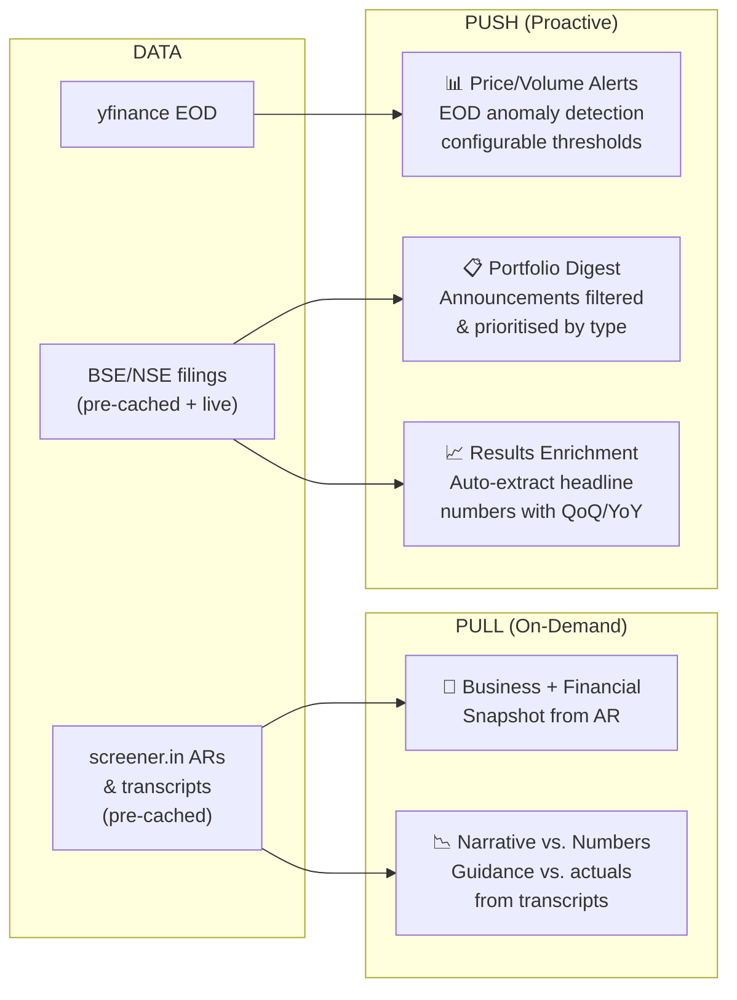

# FINN: Financial Investment Agent — Requirements Analysis

> **Challenge window:** Oct 27 – Nov 1, 2026 (5 days)
> **Today:** Oct 28, 2026 — **~4 days remaining**

---

## 1. Functional Requirements

### 1.1 Data Layer (Backend — "plumbing, not the point")

| ID | Requirement | Source | Priority |
|----|-------------|--------|----------|
| **D-1** | Ingest **end-of-day price & volume** for 15–20 NSE/BSE tickers via `yfinance` or equivalent | Brief §Backend | Must |
| **D-2** | Ingest **corporate announcements/filings** from NSE/BSE for portfolio companies | Brief §Backend | Must |
| **D-3** | Ingest **annual reports** and **concall transcripts** (links from screener.in or company IR pages) | Brief §Backend | Must |
| **D-4** | Engine must **generalise to any NSE ticker** — not hard-wired to demo set | Brief §Your companies | Must |
| **D-5** | Classify announcements into provided categories (results, M&A, fund_raise, management_change, etc.) or a custom taxonomy | Brief §Backend + Reference | Should |

### 1.2 Push Mode — Proactive Notifications

| ID | Requirement | Source | Priority |
|----|-------------|--------|----------|
| **P-1** | **Windowed digest**: Show all announcements across portfolio for a user-selectable time window (default: last 24h) | Brief §Push | Must |
| **P-2** | **Filter & prioritise**: Material announcements surface first; routine filings are collapsed/hidden | Brief §Push | Must |
| **P-3** | **Triggered alerts — announcements**: Alert on material announcement types (results, M&A, management change, etc.) | Brief §Push | Should |
| **P-4** | **Triggered alerts — price/volume**: Alert when EOD volume > ~2× recent average, or price moves ± X% in a day | Brief §Push | Should |
| **P-5** | **Configurable thresholds**: User decides what "unusual" means (volume multiplier, price % threshold) | Brief §Push | Should |
| **P-6** | **Management change enrichment**: On management change, pull short bio/background of incoming person (e.g. from LinkedIn) | Brief §Push (example) | Should |
| **P-7** | **Quarterly results enrichment**: Parse actual results filing → headline numbers (Revenue, EBITDA, PBT, PAT) with QoQ and YoY comparison | Brief §Push (example) | Should |
| **P-8** | For every other announcement type, provide a **one-line summary** and/or surface the filing at the right priority | Brief §Push | Should |

### 1.3 Pull Mode — On-Demand Research

| ID | Requirement | Source | Priority |
|----|-------------|--------|----------|
| **R-1** | **Business snapshot** — what the company does, segments, revenue mix | Brief §Pull | Pick ≥2 |
| **R-2** | **Financial snapshot** — current headline numbers (revenue, margins, PAT, key ratios) | Brief §Pull | Pick ≥2 |
| **R-3** | **Trajectory** — multi-year direction: what's growing, what's compressing | Brief §Pull | Pick ≥2 |
| **R-4** | **Balance sheet** — debt, leverage, working-capital cycle, funding structure | Brief §Pull | Pick ≥2 |
| **R-5** | **Cash quality** — cash-flow trend and cash conversion | Brief §Pull | Pick ≥2 |
| **R-6** | **Narrative vs. numbers** — where management's story and financials agree or diverge | Brief §Pull | Pick ≥2 |
| **R-7** | **Guidance** — what management guided on headline numbers | Brief §Pull | Pick ≥2 |
| **R-8** | **Bull vs. bear** — tight case each way | Brief §Pull | Pick ≥2 |
| **R-9** | All pull analysis must be **grounded in primary sources only** (annual reports + transcripts) — no broker notes, no news, no model's latent knowledge | Brief §Pull | Must |
| **R-10** | Support pull research on **3–5 additional companies** outside the portfolio for demo | Brief §Your companies | Must |

### 1.4 Portfolio & Configuration

| ID | Requirement | Source | Priority |
|----|-------------|--------|----------|
| **C-1** | User has a **mock portfolio of 15–20 NSE/BSE-listed companies** across sectors and sizes | Brief §Your companies | Must |
| **C-2** | User can **select time window** for digest (default 24h) | Brief §Push | Must |
| **C-3** | User can **configure alert thresholds** (volume multiplier, price change %) | Brief §Push | Should |
| **C-4** | User can specify which **announcement types** trigger alerts | Brief §Push | Should |

---

## 2. Non-Functional Requirements

| ID | Requirement | Source |
|----|-------------|--------|
| **NF-1** | **Mobile-first** — designed and optimised for phone screens; responsive web is acceptable delivery | Brief §Deliverable, §Submit |
| **NF-2** | **Beautiful, dense, premium design** — "no AI slop"; must feel like a thoughtfully designed product | Brief §The bar |
| **NF-3** | **Concise and interactive** — save the investor time; don't fill templates | Brief §The bar |
| **NF-4** | **Cost-efficient** — doable on free tiers; smart model routing (cheap models for bulk, strong for reasoning) | Brief §Tools |
| **NF-5** | **Caching** — avoid redundant API/LLM calls | Brief §Tools |
| **NF-6** | **Must actually run** — "a demo that doesn't run is the worst outcome" | Brief §Scope |
| **NF-7** | **Generalises** — works on any NSE ticker, not just the demo set | Brief §Your companies |
| **NF-8** | **Interaction model experimentation** — chat, voice, copilot, dashboard, or novel interface; show a point of view | Brief §Interaction model |

---

## 3. Constraints

| ID | Constraint | Impact |
|----|-----------|--------|
| **CON-1** | **5-day deadline** (Oct 27 – Nov 1) — ~4 days remaining | Scope must be ruthlessly minimal |
| **CON-2** | **Pull analysis: primary sources only** — no broker notes, news, or model's latent company knowledge | Must build RAG or extraction pipeline over ARs and transcripts |
| **CON-3** | **No model restriction** — any LLM (open-source, commercial, local) | Freedom, but must justify choices |
| **CON-4** | **Free-tier budget target** — spending is acceptable but efficiency earns bonus | Favour caching, cheap models for bulk |
| **CON-5** | **Must submit AI build history** — conversations with coding agents/LLMs | Work transparently with AI tools |
| **CON-6** | **Deliverable format**: deployed link, Expo/TestFlight, or responsive web — easy to try on a phone | Must deploy or provide easy mobile access |
| **CON-7** | **No prior finance knowledge assumed** — reference document is the knowledge base | Domain logic must be learnable from the glossary |

---

## 4. Evaluation Criteria (from brief, ranked by emphasis)

| # | Criterion | Brief's emphasis |
|---|----------|-----------------|
| 1 | **Creativity & product instinct** — the interaction model, what you *chose* to build, and how | "That's where we most want to see how you think" |
| 2 | **Judgment** — filtering signal from noise; what earns attention vs. what gets buried | "That judgment is the point" |
| 3 | **Design & density** — premium feel, mobile-first, information-dense but not cluttered | "Density and design both count" |
| 4 | **Architecture** — generalisation, model routing, caching, clean separation of concerns | "The less you spend to achieve the same result, the better" |
| 5 | **Working prototype** — it must run; thin-but-working > broad-but-broken | "A demo that doesn't run is the worst outcome" |
| 6 | **AI tool usage** — how you work with LLMs/coding agents (they review your build history) | "We want to see how you work with the tools" |

> [!IMPORTANT]
> They explicitly do **not** evaluate completeness or polish. They evaluate **what you chose** and **how well it works**.

---

## 5. Acceptance Tests

### 5.1 Smoke Tests (Must Pass)

| Test | Pass condition |
|------|---------------|
| **AT-1** | App loads on a mobile browser without errors |
| **AT-2** | Portfolio of 15–20 companies is visible with current EOD price/volume |
| **AT-3** | Digest view shows announcements for the portfolio, prioritised, for a selectable time window |
| **AT-4** | At least one pull research view works end-to-end for a company, grounded in primary sources |
| **AT-5** | Pointing the app at **an arbitrary NSE ticker** (not in the demo set) produces reasonable output |

### 5.2 Differentiation Tests (Should Pass)

| Test | Pass condition |
|------|---------------|
| **AT-6** | Management change announcement displays enriched bio of the incoming person |
| **AT-7** | Quarterly results announcement auto-extracts Revenue/EBITDA/PBT/PAT with QoQ & YoY |
| **AT-8** | Alert thresholds are user-configurable and alerts fire correctly on EOD data |
| **AT-9** | Pull research on "narrative vs. numbers" produces a comparison of management guidance vs. actuals |
| **AT-10** | Interaction model goes beyond a simple chat or table — there is a clear *point of view* |

### 5.3 Excellence Tests (Wow Factor)

| Test | Pass condition |
|------|---------------|
| **AT-11** | An evaluator, unfamiliar with the app, can complete a full push→pull workflow on mobile in <60s |
| **AT-12** | The design feels premium — comparable to a real fintech app, not a hackathon project |
| **AT-13** | Model routing is demonstrably cost-efficient (e.g., cheap model for classification, strong model for analysis) |
| **AT-14** | Voice or novel interaction modality works smoothly |

---

## 6. Ambiguities & Open Questions

| # | Ambiguity | Risk if unresolved | Recommended resolution |
|---|----------|--------------------|-----------------------|
| **A-1** | **"Primary sources only" for Pull** — Does this mean the LLM prompt must explicitly instruct "ignore your training data about this company"? How is this enforced/verified? | Evaluator may test with an obscure company to see if the model hallucinates from latent knowledge | Build a strict RAG pipeline: feed only extracted text from ARs/transcripts into context. Use system prompt to forbid outside knowledge. Acknowledge limitation in writeup. |
| **A-2** | **Announcement ingestion** — NSE/BSE don't have clean public APIs; scraping is fragile. How reliable does this need to be? | Data pipeline breaks during demo | Pre-fetch and cache a window of announcements. For live demo, have fallback to cached data. Consider BSE's RSS feeds or third-party aggregators. |
| **A-3** | **"Mobile-first" definition** — Is a responsive web app sufficient, or do they expect a native/Expo app? | Misjudging the delivery format | Brief says "deployed link, Expo/TestFlight, or responsive web" — **responsive web is explicitly acceptable**. Go with that. |
| **A-4** | **LinkedIn bio enrichment** — LinkedIn aggressively blocks scraping. How to get bios? | Feature doesn't work in demo | Use alternative sources: company press release, BSE filing itself often names background, Google search snippet, or pre-cache for demo companies. |
| **A-5** | **"Concall transcripts from screener.in"** — screener.in may rate-limit or require login for transcripts. | Can't fetch transcripts at scale | Pre-download transcripts for demo companies. Build the pipeline to generalise, but cache aggressively. |
| **A-6** | **What counts as "generalises to any NSE ticker"?** — Is it okay if AR/transcript analysis only works when those documents are available? | Evaluator picks a company with no transcripts on screener.in | Yes — the brief says "where the data is available." Gracefully degrade: show price/volume and announcements even if fundamentals aren't available. |
| **A-7** | **Alert delivery mechanism** — Push notifications on mobile web are unreliable (iOS Safari limitations). | "Push" alerts don't actually push | Reframe as "pull-to-refresh with alert badges" or use a polling mechanism. Acknowledge in writeup. Real push would need a native wrapper or PWA on Android. |
| **A-8** | **Scope of "interaction model experimentation"** — How novel do they want? Is a well-designed dashboard with chat sufficient? | Under-delivering on their most-weighted criterion | Build a **strong dashboard + contextual chat** as the base. Add one novel element (e.g., swipeable card-based triage for announcements, voice summary, or a Tinder-like "care / dismiss" interaction for alerts). |

---

## 7. Risks

| # | Risk | Likelihood | Impact | Mitigation |
|---|------|-----------|--------|-----------|
| **RK-1** | **Data pipeline fragility** — scrapers break, APIs rate-limit, sites change | High | High | Pre-cache all demo data. Build pipeline to refresh, but don't depend on live scraping for the demo. |
| **RK-2** | **LLM cost overrun** — analysing 20 annual reports + transcripts with a strong model | Medium | Medium | Use chunking + summarisation with a cheap model (e.g., Gemini Flash, GPT-4o-mini). Only escalate to a strong model for synthesis/reasoning. Cache all LLM outputs. |
| **RK-3** | **Scope creep** — trying to build all 8 pull views + all push features | High | Critical | Pick **2–3 pull views** and **1 strong push workflow**. Do them beautifully. |
| **RK-4** | **"Doesn't run" scenario** — overbuilding causes deployment failures | Medium | Critical | Deploy early (Day 1). Iterate on deployed version. Test on actual phone. |
| **RK-5** | **Design mediocrity** — spending all time on backend, UI looks like a hackathon | High | High | Start with the frontend. Use a design system. The brief says the frontend "is the heart of the challenge." |
| **RK-6** | **"Any NSE ticker" test fails** — evaluator picks an unknown company | Medium | High | Build the pipeline generically. Have a graceful "loading/fetching data for this company" flow and show whatever is available. |

---

## 8. Recommended MVP — "The Smallest Thing That Proves You Can Build the Real Thing Well"

> [!TIP]
> The brief explicitly says: *"Build the smallest thing that proves you can build the real thing well."* and *"Thin-but-working beats broad-but-broken."*

### 8.1 MVP Scope



### 8.2 What to Build (In Priority Order)

| Day | Focus | Deliverables |
|-----|-------|-------------|
| **Day 1** | **Foundation + Data + Deploy** | Responsive web app skeleton deployed. Portfolio of 15–20 tickers defined. yfinance pipeline working. BSE/NSE announcement scraper with cached fallback. Basic mobile UI shell with navigation. |
| **Day 2** | **Push Mode** | Digest view with announcement classification (LLM-based). Priority sorting. Quarterly results enrichment (headline numbers + QoQ/YoY). Price/volume anomaly detection with configurable thresholds. |
| **Day 3** | **Pull Mode** | AR + transcript ingestion from screener.in (pre-cache for demo companies). RAG pipeline for grounded analysis. Business + Financial snapshot view. Narrative vs. Numbers view (the "most valued" feature). |
| **Day 4** | **Polish + Interaction + Writeup** | Premium mobile UI polish. Novel interaction element (swipeable alert triage or voice summary). Test with arbitrary ticker. Writeup. Final deploy + test on phone. |

### 8.3 What to Deliberately Leave Out

- ❌ Management change bio enrichment (LinkedIn scraping is fragile — mention as "next step")
- ❌ Balance sheet, Cash quality, Trajectory, Bull vs. Bear views (mention as expandable from the same pipeline)
- ❌ Real-time push notifications (use pull-to-refresh with badge counts instead)
- ❌ Voice interaction (unless Day 4 has time — it's a "wow" but not core)
- ❌ Native app / Expo (responsive web is explicitly accepted)

### 8.4 The "One Wow" — Narrative vs. Numbers

> [!IMPORTANT]
> The brief calls out this specific feature as *"the kind of thing we value most."* This is the single highest-ROI feature to nail.

**What it does:** Takes the last 4 quarters of earnings call transcripts, extracts management's forward guidance (revenue growth %, margin targets, capex plans), then compares against the actual delivered numbers from the quarterly results filings.

**Why it wins:** It demonstrates:
- Deep primary-source grounding (transcripts + results)
- Analytical judgment (not just summarisation)
- The exact skill the firm values ("analysing management, not summarising them")

### 8.5 Recommended Tech Stack

| Layer | Choice | Rationale |
|-------|--------|-----------|
| **Frontend** | Next.js (responsive web) or Vite + React | Mobile-first, deployable to Vercel, easy phone access |
| **Backend** | Python (FastAPI) | Best ecosystem for yfinance, scraping, LLM orchestration |
| **LLM — Bulk** | Gemini 2.0 Flash / GPT-4o-mini | Announcement classification, extraction, summarisation — cheap |
| **LLM — Reasoning** | Claude Sonnet / GPT-4o | Narrative vs. Numbers analysis, Bull vs. Bear — quality matters |
| **Vector Store** | ChromaDB (local) or Pinecone (free tier) | RAG over annual reports and transcripts |
| **Deployment** | Vercel (frontend) + Railway/Render (backend) | Free tiers, easy mobile access via URL |
| **Data Cache** | SQLite or JSON files | Pre-cached announcements, EOD data, LLM outputs |

### 8.6 Model Routing Strategy (Bonus Points)

```
Announcement classification  →  Gemini Flash  (~$0.001/call)
Results number extraction     →  Gemini Flash  (~$0.001/call)
Transcript chunk summarisation→  GPT-4o-mini   (~$0.01/chunk)
Narrative vs. Numbers synthesis→ Claude Sonnet (~$0.05/analysis)
Business snapshot generation  →  GPT-4o-mini   (~$0.02/company)
```

**Estimated total cost for 20-company demo: < $2**

---

## 9. Decision Log — Questions for You

Before building, these decisions should be locked:

1. **Tech stack**: Next.js + Python FastAPI, or a simpler single-stack approach (e.g., all Python with Streamlit/Gradio)?
2. **Portfolio selection**: Which 15–20 companies? (Recommend: 4 large-cap, 6 mid-cap, 5 small-cap across IT, banking, pharma, FMCG, auto, energy, chemicals)
3. **Interaction model**: Dashboard-first with contextual chat, or chat-first with embedded cards?
4. **Which 2–3 Pull views to build**: Business+Financial snapshot + Narrative vs. Numbers is the recommended pair. Add a third?
5. **Deployment target**: Vercel + Railway, or something else?
